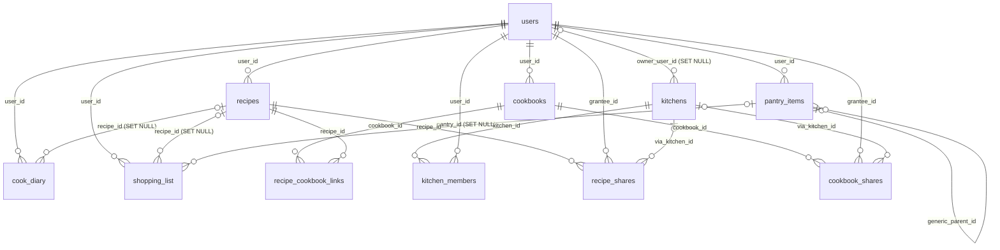
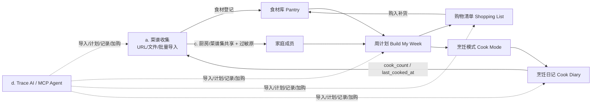

# CookTrace 业务场景说明

> 技术实现见 [技术架构文档](./技术架构文档.md)

本文只描述"谁、在什么场景、做成什么事"。所有描述均以仓库内代码与 README 为准，括号内标注主要依据文件。

**术语**：菜谱（Recipe）、食材库（Pantry）、烹饪日记（Cook Diary）、购物清单（Shopping List）、菜谱集（Cookbook）、厨房（Kitchen）、烹饪模式（Cook Mode）、周计划（Build My Week）。

---

## 1. 产品定位

- **自托管、隐私优先**：服务端、PWA 与源码免费；数据留在用户自己的硬件上，只有用户主动启用第三方集成（Open Food Facts、USDA、AI 提供方）时数据才会离开本地网络（README.md）。
- **单容器部署**：Node/Express + SQLite 服务端以单个 Docker 容器运行，同时提供 Web PWA，并配有 Android（Capacitor）与 Wear OS 客户端（README.md、ARCHITECTURE.md）。
- **目标用户**：个人厨师，以及共用一台服务器的家庭/合租成员。首次启动向导可开启多用户管理并创建管理员（README.md）；厨房的定位就是"家庭/室友"共享（server/routes/kitchens.js 头注释）。

## 2. 角色

| 角色 | 能做什么 | 不能做什么 |
|---|---|---|
| **管理员（Admin）** | 用户管理（列出、删除、改角色、重置密码）、发邀请、关闭用户管理、全库备份、OIDC 配置、Webhook、应用配置（`requireAdmin`，server/routes/auth.js 等）；可编辑/恢复任意菜谱、删除任意评论（recipes.js 中 `role === 'admin'` 分支） | 管理员身份不会让 MCP 越权：MCP 工具只按令牌所属用户 `WHERE user_id = ?` 查询（server/lib/mcp/tools/index.js） |
| **家庭成员（普通用户）** | 管理自己的菜谱、食材库、烹饪日记、购物清单、菜谱集；创建/加入厨房；向他人或厨房共享菜谱和菜谱集。在厨房中担任 **Sous Chef（`sous`）** 时，可编辑经该厨房共享给自己的菜谱和菜谱集（重命名、封面、增删其中菜谱）（`_canEditViaKitchen`，server/routes/recipes.js、server/routes/cookbooks.js） | 看不到他人的私有数据；角色为 `member` 时，收到的共享菜谱和菜谱集只读；删除菜谱集、继续转共享仅限所有者（server/routes/cookbooks.js）；只有厨房所有者可以改成员角色或转让厨房（kitchens.js） |
| **公开链接访客** | 无需账号，凭菜谱的 `share_token` 打开只读菜谱页（server/routes/share.js 挂载于 `/api/r`，不要求登录且豁免初始化闸门；页面入口 `/r/:token`，见 server/index.js） | 看不到 user_id、visibility 等账号信息；不能写入；令牌被移除或菜谱被删后无法访问 |
| **外部 AI Agent** | 用 API Token 通过 MCP Streamable HTTP（`/api/mcp`）接入，读/写/破坏三级权限见 §4.d（server/routes/mcp.js） | 默认关闭（`MCP_ENABLED`）；缺少任一道门槛，对应工具不会出现在 `tools/list` 中；不能跨用户访问 |

## 3. 核心业务对象

| 对象 | 表 | 业务含义 |
|---|---|---|
| 菜谱（Recipe） | `recipes` | 食材/步骤（JSON）、份数 `servings`、可见性 `private`/`group`、`share_token`、过敏原修正 `allergen_overrides`、`cook_count`/`last_cooked_at` 等字段；另有版本历史表 `recipe_revisions` |
| 食材库（Pantry） | `pantry_items` | 是否有货 `in_stock`、数量/单位、到期日 `expires_on`、过敏原 `allergens`/`traces`、通用品与变体（`generic_parent_id`） |
| 烹饪日记（Cook Diary） | `cook_diary` | `kind = cooked/planned`，即"已做"与"计划"共用一张表；记录份数、餐次、评分、照片和菜谱版本 `recipe_rev` |
| 购物清单（Shopping List） | `shopping_list` | 可关联食材库条目 `pantry_id` 和菜谱 `recipe_id`；`sources` 记录数量来自哪个计划/菜谱 |
| 菜谱集（Cookbook） | `cookbooks` + `recipe_cookbook_links` | 命名集合，与菜谱多对多；支持智能集（`is_smart` + `smart_filter_json`） |
| 厨房（Kitchen） | `kitchens` + `kitchen_members` | 用户软分组；成员角色 owner/sous/member，每人可单独开启 `auto_share`。它是"共享宏"，不是新的数据归属边界（kitchens.js） |

> 注：菜谱食材与食材库之间通过食材 JSON 中的 `pantry_item_id` 关联（src/lib/plan-ideas.js），这不是数据库外键，所以没有画进上图。

## 4. 核心场景

### a. 菜谱收集

- **触发者**：家庭成员（也可由 Trace AI 或 MCP 的 `import_recipe_from_url` 代为发起）。
- **主流程**：
  1. **URL 导入**（`POST /api/recipes/scrape`）：有三档引擎：**Standard**（解析页面内嵌的结构化数据）、**Enhanced**（Python recipe-scrapers）、**Smart**（AI 提取，需要先配置 AI 提供方）。系统先用用户设置的首选引擎，失败后再回退：Standard 失败且已配置 AI 时转 Smart；Enhanced 失败时按设置转 Smart，再转 Standard；Smart 失败时转 Standard（recipes.js `_scrapeUrlOnly`）。
  2. **文件 / 照片导入**（`POST /api/recipes/import`）：解析 schema.org/Recipe、Mealie、Tandoor 的 JSON 或文本（server/lib/recipe-importers.js `importRecipeFromText`）。照片导入见 README。
  3. **从其他应用批量导入**：先上传压缩包扫描（`/import-zip/scan`），再勾选提交（`/import-zip/commit`）；支持 Mealie / Mealime / Paprika / Tandoor（recipe-importers.js、README.md）。
  4. **去重**：同一用户下名称（不区分大小写）或 `source_url` 相同即视为重复（`_findImportDuplicate`）。策略 `dedup` 有三种：`skip`（默认）、`replace`、`force`。
- **结果**：新菜谱入库；默认把食材登记进食材库（`addToPantry` 默认开启）；若作者在某厨房开启了自动共享，新菜谱会自动共享给该厨房的其他成员（server/lib/auto-share.js）。

### b. 从食材库到餐桌的主线

- **触发者**：家庭成员。
- **主流程**：
  1. **食材库**：维护库存与到期日；"Uses Up"列出快到期的食材以及能用上它们的菜谱（src/lib/plan-ideas.js、README.md）。
  2. **周计划（Build My Week）**：根据菜谱、食材库和本周已有计划挑出一周晚餐，写入烹饪日记，记为 `kind='planned'`（src/lib/plan-ideas.js、src/components/diary/BuildWeekSheet.svelte）。
  3. **购物清单**：`POST /api/shopping/from-plan` 按周计划生成，`/from-recipe/:id` 按单个菜谱生成并跳过有货的食材；数量按计划份数缩放，并跨菜谱累加（shopping.js、server/lib/shopping-plan.js）。
  4. **烹饪模式（Cook Mode）**：在菜谱页逐步烹饪，计时器在锁屏状态下也会响铃（README.md、src/stores/cookMode.js）。
  5. **烹饪日记**：做完后记录 `cooked`，可附份数、评分和照片；服务端同步重算菜谱的 `cook_count` 和 `last_cooked_at`（server/routes/cook-diary.js）。
- **结果**：库存、计划、采购、烹饪、记录形成一条完整链路；调度器每 15 分钟推送当日计划提醒和购物清单催办（server/lib/scheduler.js）。

### c. 家庭共享

- **触发者**：菜谱/菜谱集的所有者、厨房所有者。
- **主流程**：
  1. 创建厨房并按用户名邀请成员（kitchens.js `POST /:id/members`）。
  2. 通过"共享到厨房"把菜谱或菜谱集展开成逐个用户的授权，记录在 `recipe_shares` / `cookbook_shares` 中，并标记 `via_kitchen_id`（`/share-recipe`、`/share-cookbook`）。
  3. 成员开启**自动共享（Auto-Share）**后，自己新建的菜谱会自动共享给同厨房的其他成员；开启时还会回填自己已有的菜谱（db.js 注释、auto-share.js）。
  4. **过敏原提醒**：家庭成员（Household）的过敏、饮食偏好、不吃的食物和在家日期都存成设置项。菜谱过敏原按以下顺序判定：①关联食材库条目的标签 →②食材名称关键词 →③菜谱自身的修正（add/remove）。`conflicts()` 只统计当天在家的人（server/lib/allergens.js）。
- **结果**：成员在"与我共享"中看到内容；Sous Chef 可以编辑共享来的菜谱；每道菜谱都显示过敏原警示，并可按"对所有人安全"（Safe for Everyone）筛选（README.md）。成员离开或被移出厨房时，该厨房带来的共享全部撤销（db.js 注释）。

### d. AI 辅助

- **触发者**：家庭成员（Trace AI）；外部 Agent（MCP）。
- **Trace AI 对话**：共 **21 个工具**（src/lib/aiChat.js 中 21 个 `name:` 定义），包括读取菜谱/食材库/烹饪日记/购物清单/菜谱集，以及 `log_cook`、`plan_cook`、`add_to_shopping`、`add_to_pantry`、`add_to_cookbook`、`import_recipe_from_url`、`create_recipe` 等写操作。提供方有 4 种：`claude` / `openai` / `gemini` / `oai-compat`（可接 Ollama 等本地端点）（server/routes/ai.js `POST /chat`）。
- **MCP 接入**（server/routes/mcp.js、server/lib/mcp/tools/index.js）：

| 级别 | 门槛 | 工具 |
|---|---|---|
| 读 | `MCP_ENABLED=1` + 令牌 scope `mcp:read` | search_recipes、get_recipe、recent_recipes、list_pantry、list_shopping_list、list_cook_diary（6 个） |
| 写 | 额外要求 `MCP_WRITE_ENABLED=1` + `mcp:write` | log_cook、add/check_shopping_item、update_pantry_stock、update_recipe、set_recipe_image、plan_cook、update_plan（8 个） |
| 破坏 | 额外要求 `MCP_DESTROY_ENABLED=1` + `mcp:destroy`，且每次调用都带 `confirm=true` | create_recipe、add_pantry_item、delete_cook_diary_entry、remove_shopping_item、import_recipe_from_url、delete_recipe（6 个） |

- **结果**：用户用自然语言或外部 Agent 完成记录、计划、采购和导入，写入的数据与手动操作走同一套业务表。

## 5. 业务闭环与关键规则

**关键业务规则**

1. **可见性**：一个菜谱可见的条件是：所有者、管理员、经厨房获得编辑权的 Sous Chef、`visibility='group'`，或在 `recipe_shares` 中有授权，满足任一即可；编辑仅限前三类（recipes.js `_historyAccess`）。Sous Chef 权限在每次请求时实时查询，降级或被移出后立即失效。
2. **同步冲突裁决**：逐字段比较，较新的编辑胜出，彼此关联的字段一起保留或一起放弃；"先删后改"时删除失效，"先改后删"的编辑不会让记录复活；时间相同时，两次编辑之间以后到达的为准，编辑与删除之间以删除为准（server/lib/field-merge.js）。
3. **份数缩放**：缩放系数 = 计划份数 ÷ 菜谱份数，任一方未知时取 1；购物清单行通过 `sources` 记录每份来源。重建同一周或修改计划时，只替换计划带来的那部分数量，手动输入的部分保留（server/lib/shopping-plan.js）。
4. **导入去重**：同一用户下名称（不区分大小写）或 `source_url` 相同即视为重复，默认跳过（recipes.js）。
5. **MCP 双门槛**：每一级都必须同时满足"服务端开关 + 令牌 scope"，缺一项则对应工具不会注册（server/routes/mcp.js、server/lib/mcp/tools/index.js）。
