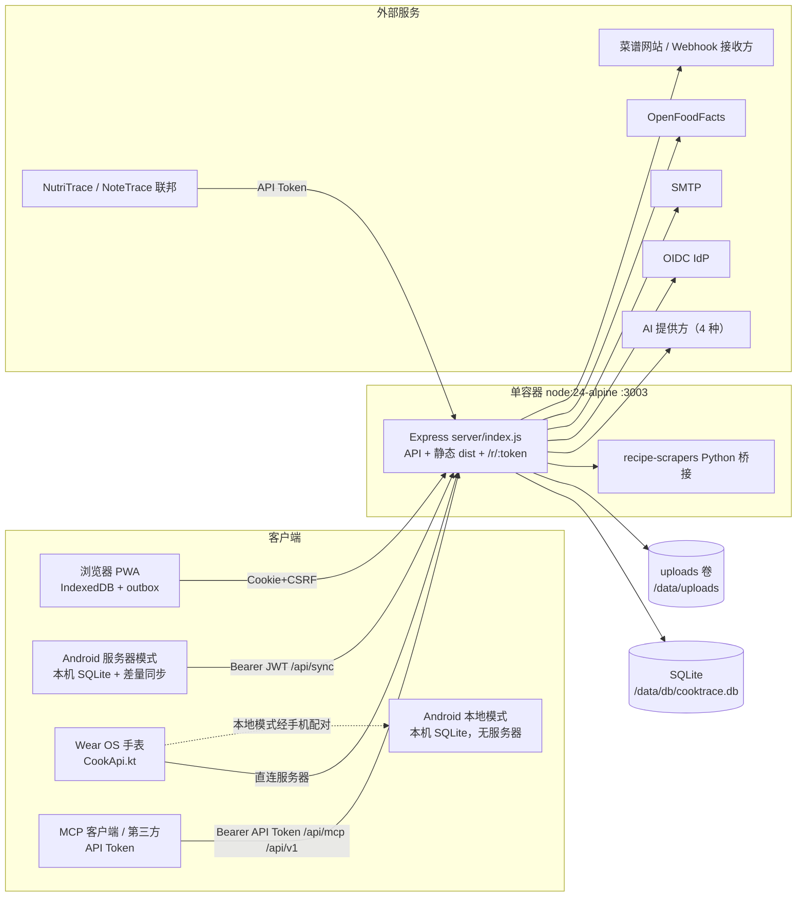
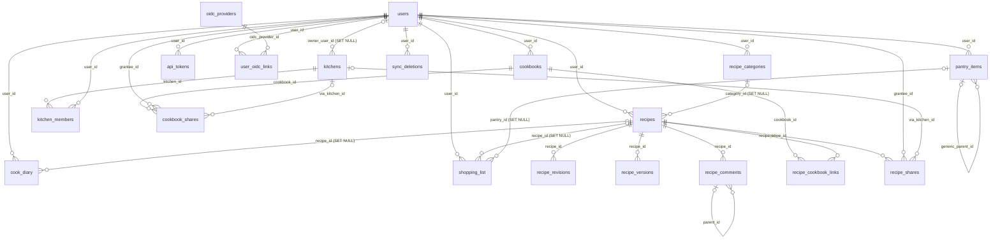
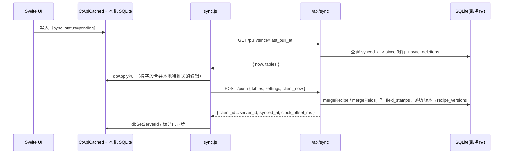

# CookTrace 技术架构文档

> 业务背景见 [业务场景说明](./业务场景说明.md)。本文所有内容均以仓库代码为准。

CookTrace 是一款自托管的烹饪应用，管理菜谱（Recipe）、食材库（Pantry）、烹饪日记（Cook Diary）、购物清单（Shopping List）、菜谱集（Cookbook）和厨房（Kitchen，多人共享空间），并提供烹饪模式（Cook Mode）和周计划（Build My Week）。

## 1. 技术栈

| 层 | 技术 | 版本（来源） |
|---|---|---|
| 前端框架 | Svelte | ^5.55.9（`package.json`，应用版本 1.5.0-dev02） |
| 构建 | Vite / @sveltejs/vite-plugin-svelte | ^7.3.6 / ^6.2.4 |
| PWA | vite-plugin-pwa / workbox-window | ^1.3.0 / ^7.4.1 |
| 路由 / 国际化 | svelte-spa-router（hash 路由）/ svelte-i18n | ^4.0.1 / ^4.0.1 |
| 移动端 | Capacitor core/android/cli | ^8.3.0 |
| 移动端本地库 | @capacitor-community/sqlite | ^8.1.0 |
| 语言 | TypeScript（仅用于类型检查与配置） | ^6.0.2 |
| 服务端 | Node.js / Express | node:24-alpine（`Dockerfile`）/ ^5.2.1（`server/package.json`，版本 1.1.1） |
| 数据库 | better-sqlite3（SQLite，WAL 模式） | ^13.0.3 |
| 鉴权 | jsonwebtoken / bcryptjs / openid-client | ^9.0.2 / ^3.0.3 / ^5.7.1 |
| MCP | @modelcontextprotocol/sdk / zod | ^1.30.0 / ^4.5.4 |
| 其他 | multer ^2.4.0、adm-zip ^0.6.1、nodemailer ^10.0.12、undici ^8.12.4、cheerio、pdf-parse | `server/package.json` |
| 菜谱抓取 | Python `recipe-scrapers>=14.0.0` | `Dockerfile` |
| 手表端 | Kotlin（Wear OS） | `android/wear/` |

## 2. 整体架构

- 前端是同一套 Svelte 代码：浏览器中以 PWA 形式运行，Capacitor 将其打包成 Android 应用（`capacitor.config.ts`：appId `com.cooktrace.app`，hostname `app.cooktrace.local`，androidScheme `https`）。
- Wear OS（`android/wear/src/main/java/com/cooktrace/app/wear/`）只使用少量接口：读取购物清单、勾选条目、读取菜谱、记录烹饪。本地模式下由手机（`Pairing.kt` / `PairingService.kt`）代理访问。

## 3. 服务端

### 3.1 请求管线（`server/index.js`，按代码实际顺序）

1. 安全头 `framingHeaders(FRAME_ANCESTORS)`（`lib/frame-ancestors.js`）
2. 按路径设置的 `express.json` 体积上限：`/api/data/import` 和 `/api/sync/push` 为 25mb（push 会先记录 `req.receivedAt`），`/api/mcp` 为 18mb，嵌入照片的路由使用单独上限，其他路由默认 1mb
3. `cookieParser`
4. CORS（`lib/cors.js`）：精确匹配 `https://app.cooktrace.local`、`https://localhost` 和 `PUBLIC_URL`，响应带 `Vary: Origin`
5. `crossSiteGuard`（`lib/cross-site.js`）：拒绝跨站页面发起的非 GET/HEAD/OPTIONS 请求
6. `/uploads`：私有路径直接返回 404（`lib/upload-paths.js`），其余走静态服务
7. `/api/proxy`（挂在认证之前）
8. `authenticate` → `rememberAdminOrigin` → `csrfProtect`
9. 请求日志 → `/api` 统一加 `Cache-Control: no-store` → `privateFieldsOut`（`lib/private-fields.js`，过滤响应中的私有字段）
10. `/api/oidc/callback`、`/api/health`
11. 初始化闸门（setup-required）：尚未创建管理员时，除认证接口和 `/r/` 外一律返回 503
12. 挂载业务路由（见 3.2）
13. 静态 `dist`、`/r/:token` 公开分享页、SPA 兜底 `/{*splat}`
14. 整个 router 挂到 `BASE_URL || '/'`，之后是错误处理和 `app.listen`

### 3.2 路由（`server/routes/`）

| 业务域 | 挂载点 → 文件 |
|---|---|
| 认证与账户 | `/api/auth` auth.js、`/api/auth/oidc` oidc.js、`/api/auth/two-step` two-step.js、`/api/admin/oidc` oidc-admin.js |
| 菜谱 / 菜谱集 | `/api/recipes` recipes.js、`/api/cookbooks` cookbooks.js、`/api/r` share.js |
| 食材库 / 单位 | `/api/pantry` pantry.js、`/api/units` units.js、`/api/off` off-contribute.js |
| 日记 / 购物 | `/api/cook-diary` cook-diary.js、`/api/shopping` shopping.js |
| 厨房（共享） | `/api/kitchens` kitchens.js |
| 同步 | `/api/sync` sync.js |
| 数据 / 备份 | `/api/data` data.js、`/api/full-backup` full-backup.js、`/api/upload` upload.js |
| 设置 / 配置 | `/api/settings` settings.js、`/api/app-config` app-config.js、`/api/updates` updates.js |
| AI | `/api/ai` ai.js |
| 集成 | `/api/mcp` mcp.js、`/api/v1` api/v1/index.js、`/api/tokens` 与 `/api/admin/api-tokens` api-tokens.js、`/api/admin/webhooks` webhooks.js、`/api/nt` nt-federation.js、`/api/notify` notify.js、`/api/proxy` proxy.js |

### 3.3 `server/lib` 按职责分组

- **鉴权与安全**：api-tokens、token-crypto、totp、two-step、session-version、password-strength、oidc、cors、cross-site、frame-ancestors、ssrf-guard、outbound-policy、upload-paths、private-fields、secret-settings
- **同步**：field-sync（与前端共用的合并规则）、field-merge、field-stamps、sync-clock、sync-fields、rest-merge
- **菜谱**：recipe-versions（冲突中落败的版本）、recipe-history（内容修订）、recipe-importers、recipe-scraper、recipe-scrapers-bridge、heuristic-recipe-parser、recipe-ai-fallback、ingredient-line、quantity、image-localizer
- **AI**：ai-models、openai-chat-params（入口为 `server/ai.js`；对话接口 `server/routes/ai.js` 支持 `claude` / `openai` / `gemini` / `oai-compat` 4 种提供方）
- **食材与营养**：nutrition-derive、allergens、pantry-tree（变体树）、pantry-usage、off-contribute
- **购物与共享**：shopping-items、shopping-plan、sharing、auto-share、link-grant、smart-cookbook
- **运维**：scheduler、backup-schedule、update-check、webhooks、webhook-delivery、push-notify

## 4. 数据层（`server/db.js`）

SQLite 开启 `journal_mode=WAL` 和 `foreign_keys=ON`。

上图省略了配置类和辅助表：user_settings、app_config、password_reset_tokens、invite_tokens、webhooks、ai_chat_history、oauth_state、pantry_categories、custom_units、disabled_units、notification_log。

- **软删除**：recipes、pantry_items、cook_diary、shopping_list、cookbooks、recipe_comments、recipe_revisions、user_settings 带 `deleted_at` 列，删除只打标记，并随同步下发。
- **删除同步**：参与同步的表都有服务器时钟列 `synced_at`。没有 `deleted_at` 列、会被硬删除的 4 张表（recipe_categories、pantry_categories、custom_units、ai_chat_history）上有 `AFTER DELETE` 触发器 `trg_<表>_sync_del`，删除时写一条记录到 `sync_deletions(user_id, table_name, row_id)`，供客户端拉取；超过 365 天的记录会在启动时清理。
- **字段级时间戳**：各同步表上的 `field_stamps` 列（db.js:1112 起，由触发器维护）记录每个字段最后一次变更的 `[synced_at, edited_at]`，作为按字段合并的依据。
- **版本与历史**：`recipe_revisions` 是不可变的内容修订，`recipes.rev` 指向当前修订，`cook_diary.recipe_rev` 记录做菜时使用的修订；`recipe_versions` 保存同步冲突中落败的一方，以及恢复操作中被替换的副本（`reason` 默认为 `'conflict'`）。
- **启动迁移**：没有独立的迁移框架。启动时依次执行 `CREATE TABLE/INDEX/TRIGGER IF NOT EXISTS`，再用 `columnExists()` 判断是否需要 `ALTER TABLE ADD COLUMN`，必要时回填数据。整个过程幂等。

## 5. 前端与离线同步

### 5.1 `src/lib/api.js` 分派

`NtApi`/`CtApi` 是 Proxy，按运行环境选择实现：

| 环境 | 实现 | 存储 |
|---|---|---|
| 浏览器（`!isNative`） | `createOfflineApi(_CtApiHttp)`（`offline-api.js`） | IndexedDB 镜像 + outbox，联网后重放（有意不用 Background Sync API） |
| Android 且没有服务器地址 | `CtApiNative`（`api-native.js`） | 本机 SQLite（`db-native.js`） |
| Android 且配置了服务器 | `CtApiCached`（`api-cached.js`）；厨房、共享、版本、导入等 `SERVER_ONLY_METHODS` 直接走 `_CtApiHttp` | 本机 SQLite，写入的行标为 `sync_status='pending'`，由 `sync.js` 推送 |

### 5.2 同步协议

- **先拉后推**：`fullSync`（`src/lib/sync.js`）依次执行在线探测 → `pullChanges`（`GET /api/sync/pull?since=`）→ 校正本地照片地址 → `pushChanges`（`POST /api/sync/push`），被推迟的行最多再补推 3 轮。`startSyncLoop` 每 30 秒触发一次，App 恢复到前台时也会触发。
- **按字段合并**：菜谱走 `mergeRecipe`（`lib/recipe-versions.js`），其他表走 `mergeFields`（`lib/field-merge.js`），字段清单在 `lib/sync-fields.js` 中定义，启动时会和 `routes/sync.js` 的 TABLES 做一致性校验。
- **冲突裁决**（规则在 `field-sync.js`，服务端由 `server/lib/field-merge.js` 调用；前后端 `src/lib/field-sync.js` 与 `server/lib/field-sync.js` 是同一份文件，`scripts/field-sync.test.js` 校验两份一致）：
  - 每个字段取较新的编辑，同组字段一起取舍；
  - 编辑基于 `base`（所依据副本的 `synced_at`），如果服务端在 base 之后没改过该字段，直接采纳客户端的值；
  - 早于后续编辑的删除不生效，早于删除的编辑不会让行复活；
  - 时间按整秒比较：两次编辑打平时后到达者胜，编辑和删除打平时删除胜；
  - 客户端时钟偏差由 `client_now` 与 `req.receivedAt` 计算得出（`lib/sync-clock.js`）；
  - 菜谱冲突中落败的一方存入 `recipe_versions`，可以在应用里恢复。
- **外键翻译**：push 时按依赖顺序处理各表，把客户端 `client_id` 映射成 `server_id`。

## 6. 安全要点

- **会话**：登录后签发 JWT，放在 Cookie 中（`routes/auth.js`：`httpOnly`、`sameSite: 'lax'`、`secure`，有效期 30 天；仅当 `INSECURE_COOKIES=1` 时允许走 HTTP）。PWA 的写请求要带 `X-CSRF-Token` 头（`middleware/csrf.js`）。原生 App 使用 `Authorization: Bearer`。`lib/session-version.js` 支持“在所有设备上退出”。
- **OIDC**：基于 openid-client（`lib/oidc.js`、`routes/oidc.js`），身份提供方可在 `/api/admin/oidc` 管理，账户通过 `user_oidc_links` 关联。
- **两步登录**：TOTP（`lib/totp.js`、`lib/two-step.js`、`routes/two-step.js`）。
- **API Token**（`lib/api-tokens.js`、`middleware/bearer-auth.js`）：作用域包括 `read:recipes`、`read:pantry`、`shopping`、`mcp:read`、`mcp:write`、`mcp:destroy`。MCP 端点本身需 `MCP_ENABLED=1`；三级工具（读 6 / 写 8 / 破坏 6，见 `server/lib/mcp/tools/index.js`）各自要求"服务端开关 + 令牌 scope"同时满足：读仅需 `mcp:read`，写需 `MCP_WRITE_ENABLED=1` + `mcp:write`，破坏需 `MCP_DESTROY_ENABLED=1` + `mcp:destroy` 且每次调用带 `confirm=true`（`server/routes/mcp.js`）。`/api/v1` 公开 API 另由 `PUBLIC_API_ENABLED`（读）、`PUBLIC_API_WRITE_ENABLED`（写）控制。
- **其他防护**：
  1. CORS 白名单精确匹配，`crossSiteGuard` 拦截跨站写请求；
  2. `FRAME_ANCESTORS` 控制页面能否被嵌入（frame-ancestors 头）；
  3. 出站请求经过 SSRF 防护（`lib/ssrf-guard.js`、`lib/outbound-policy.js`）；
  4. 按路径限制请求体大小，`middleware/rate-limit.js` 做限流；
  5. 私有上传路径返回 404，`privateFieldsOut` 过滤响应中的私有字段，`/api` 响应设为 `no-store`；
  6. 设置项中的敏感值加密存储（`lib/secret-settings.js`、`lib/token-crypto.js`）。

## 7. 部署

- **两阶段构建**（`Dockerfile`）：
  1. `build` 阶段：`node:24-alpine`（`$BUILDPLATFORM`），执行 `npm run build` 生成 `dist`；
  2. 运行阶段：`node:24-alpine`，安装 python3 和 `recipe-scrapers`，server 只装生产依赖，从 build 阶段复制 `dist`。

  容器暴露 3003 端口，入口脚本 `server/docker-entrypoint.sh` 支持 `*_FILE` 形式的 secrets，最后执行 `node index.js`。
- **数据卷**（`docker-compose.yml`）：`${DATA_DB_PATH}:/data/db`、`${DATA_UPLOADS_PATH}:/data/uploads`。
- **关键环境变量**：

| 变量 | 作用 |
|---|---|
| `JWT_SECRET` | 会话签名密钥 |
| `DB_PATH` / `UPLOADS_PATH` | `/data/db/cooktrace.db` / `/data/uploads` |
| `RECOVERY_TOKEN` | 管理员账户恢复 |
| `PUBLIC_URL` / `BASE_URL` | 对外地址（同时加入 CORS 白名单）/ 子路径部署 |
| `FRAME_ANCESTORS` | 允许嵌入本应用的来源 |
| `SMTP_HOST/PORT/SECURE/USER/PASS/FROM` | 邮件（重置密码、邀请） |
| `INSECURE_COOKIES` | 局域网 HTTP 环境下放开 Cookie 的 Secure 要求 |
| `IMPORT_ZIP_MAX_MB` | 导入 zip 的大小上限（默认 512） |
| `MCP_*_ENABLED` / `PUBLIC_API_*` | MCP 与公开 API 的开关 |
| `LOG_LEVEL` | 日志级别 |

## 8. 关键设计取舍

1. **单容器加 SQLite**：自托管部署简单，备份就是复制文件；代价是只能单机运行，写入要串行。用 WAL 模式缓解读写冲突。
2. **本地优先，按字段合并**：手机离线时完全可用，冲突按字段裁决，而不是整行“最后写入者胜”，落败的菜谱版本保留下来可以恢复。代价是协议更复杂，前后端必须共用 `field-sync.js` 并靠测试保证一致。
3. **同一套前端，三种数据实现**：Proxy 分派让页面代码不需要关心运行环境；浏览器用 IndexedDB outbox，原生端用 SQLite。代价是同一个功能要在三处实现，其中多用户协作类功能只能在线使用（`SERVER_ONLY_METHODS`）。
4. **启动时幂等迁移**：不引入迁移工具，升级时直接替换镜像即可；代价是 `db.js` 越来越长，表结构演进依赖 `columnExists` 判断。
5. **用 Python 抓取菜谱**：借助成熟的 `recipe-scrapers` 支持大量网站，代价是镜像里要带 Python 运行时，并多一层进程桥接。
